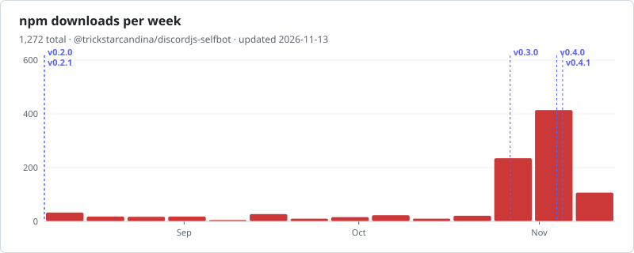

**English** | [Tiếng Việt](./README.vi.md)

<div align="center">

<h1>discordjs-selfbot</h1>

<p><strong>discord.js v14 for user accounts.</strong><br>
A successor to the archived <a href="https://github.com/aiko-chan-ai/discord.js-selfbot-v13"><code>discord.js-selfbot-v13</code></a>, built on <a href="https://github.com/discordjs/discord.js">discord.js</a> <code>v14.28.1</code>.</p>

<p>
<a href="https://www.npmjs.com/package/@trickstarcandina/discordjs-selfbot"></a>
<a href="https://npm-stat.com/charts.html?package=%40trickstarcandina%2Fdiscordjs-selfbot"></a>
<a href="https://npm-stat.com/charts.html?package=%40trickstarcandina%2Fdiscordjs-selfbot"></a>
<a href="https://www.npmjs.com/package/@trickstarcandina/discordjs-selfbot?activeTab=code"></a>
<a href="./typings/index.d.ts"></a>
</p>

<p>
<a href="https://github.com/discordjs/discord.js/tree/14.28.1"></a>
<a href="./package.json"></a>
<a href="https://github.com/trickstarcandina/discordjs-selfbot/actions/workflows/publish.yml"></a>
<a href="https://github.com/trickstarcandina/discordjs-selfbot/actions/workflows/security.yml"></a>
<a href="./LICENSE"></a>
</p>

<p>
<a href="https://www.npmjs.com/package/@trickstarcandina/discordjs-selfbot"><b>npm</b></a> ·
<a href="https://github.com/trickstarcandina/discordjs-selfbot/pkgs/npm/discordjs-selfbot"><b>GitHub Packages</b></a> ·
<a href="https://github.com/trickstarcandina/discordjs-selfbot/releases"><b>Releases</b></a> ·
<a href="./CHANGELOG.md"><b>Changelog</b></a> ·
<a href="./docs/API.md"><b>API</b></a> ·
<a href="./examples"><b>Examples</b></a>
</p>

</div>

**discordjs-selfbot** lets you log in to Discord as a **user** (not a bot) and
automate that account with the familiar [discord.js](https://github.com/discordjs/discord.js)
v14 API. On top of discord.js it adds what only user accounts have: friends,
group DMs, calls, rich presence, invoking slash commands, voice, and more.

> [!CAUTION]
> Automating a user account **violates Discord's Terms of Service** and can get the
> account disabled. Use at your own risk, and prefer a throwaway account.

## Features

- **Login** with a token, a QR code, or email and password (2FA supported)
- **REST** that looks like the official client: header spoofing, TLS fingerprint,
  proxy and captcha support
- **Relationships**: friends, blocks, friend requests, notes
- **Account**: sessions, settings, billing
- **Group DMs and calls**
- **Presence**: custom status, rich presence, Spotify RPC
- **Interactions**: invoke slash commands and other bot interactions as a user
- **Voice, video and Go Live**, with DAVE end-to-end encryption
- **WebEmbed** for embed-like messages
- **v13 compatibility layer** and a codemod for migrating old code
- **TypeScript** typings included

The project is **pre-1.0**: the API can still change between minor versions, and
every breaking change is listed in the [changelog](./CHANGELOG.md).

## Installation

Requires **Node.js 22.12** or newer.

```sh
npm install @trickstarcandina/discordjs-selfbot
```

Voice is optional and needs a few extra pieces, none of them bundled:

```sh
npm install @snazzah/davey      # DAVE end-to-end encryption, required by Discord
npm install @discordjs/opus     # or opusscript, to send audio
# and ffmpeg on PATH
```

Every release is also published to
[GitHub Packages](https://github.com/trickstarcandina/discordjs-selfbot/pkgs/npm/discordjs-selfbot).

## Quick start

```js
const { Client } = require('@trickstarcandina/discordjs-selfbot');

const client = new Client(); // user accounts don't use intents

client.on('ready', () => {
  console.log(`Logged in as ${client.user.tag}`);
  console.log(`${client.relationships.friendCache.size} friends`);
});

client.login(process.env.DISCORD_TOKEN);
```

More runnable scripts (QR and password login, rich presence, slash commands, group
DMs, WebEmbed, proxy and voice) are in [`examples/`](./examples).

## Documentation

| Document                                  | Contents                                              |
| ----------------------------------------- | ----------------------------------------------------- |
| [API reference](./docs/API.md)            | Everything this fork adds on top of discord.js        |
| [Migration guide](./MIGRATION.md)         | Moving from `discord.js-selfbot-v13`, and the codemod |
| [Changelog](./CHANGELOG.md)               | Release notes                                         |
| [discord.js docs](https://discord.js.org) | Everything unchanged from upstream                    |

## Contributing

```sh
git clone https://github.com/trickstarcandina/discordjs-selfbot.git
cd discordjs-selfbot
npm install
npm test        # unit tests + TypeScript checks
npm run lint
```

User-account code goes in **new files**. Editing a file inherited from discord.js
is a last resort and must be recorded in [`UPSTREAM.md`](./UPSTREAM.md), which also
explains how upstream releases are merged in. To check changes against a real
account, see [`scripts/smoke/`](./scripts/smoke/README.md).

## Security

Please report vulnerabilities privately as described in [`SECURITY.md`](./SECURITY.md).

## License

[GPL-3.0-or-later](./LICENSE). The voice stack is ported from
`discord.js-selfbot-v13` (GPL-3.0); code inherited from discord.js remains
available under [Apache-2.0](./LICENSE-APACHE). See [`NOTICE`](./NOTICE) for
attribution.

## Stats

Weekly downloads from npmjs.com (GitHub Packages not included), redrawn every day
by the [`stats` workflow](./.github/workflows/stats.yml), with a dashed line for each
release. Click the chart for npm-stat's daily breakdown.

<div align="center">

<a href="https://npm-stat.com/charts.html?package=%40trickstarcandina%2Fdiscordjs-selfbot">
  <picture>
    <source media="(prefers-color-scheme: dark)" srcset="https://raw.githubusercontent.com/trickstarcandina/discordjs-selfbot/stats/downloads-dark.svg">
    
  </picture>
</a>

<a href="https://star-history.com/#trickstarcandina/discordjs-selfbot&Date">
  <picture>
    <source media="(prefers-color-scheme: dark)" srcset="https://api.star-history.com/svg?repos=trickstarcandina/discordjs-selfbot&type=Date&theme=dark">
    
  </picture>
</a>

</div>
