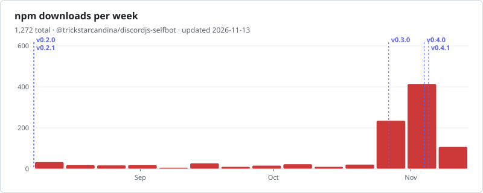

[English](./README.md) | **Tiếng Việt**

<div align="center">

<h1>discordjs-selfbot</h1>

<p><strong>discord.js v14 cho tài khoản người dùng.</strong><br>
Kế nhiệm <a href="https://github.com/aiko-chan-ai/discord.js-selfbot-v13"><code>discord.js-selfbot-v13</code></a> đã archive, xây trên <a href="https://github.com/discordjs/discord.js">discord.js</a> <code>v14.28.0</code>.</p>

<p>
<a href="https://www.npmjs.com/package/@trickstarcandina/discordjs-selfbot"></a>
<a href="https://npm-stat.com/charts.html?package=%40trickstarcandina%2Fdiscordjs-selfbot"></a>
<a href="https://npm-stat.com/charts.html?package=%40trickstarcandina%2Fdiscordjs-selfbot"></a>
<a href="https://www.npmjs.com/package/@trickstarcandina/discordjs-selfbot?activeTab=code"></a>
<a href="./typings/index.d.ts"></a>
</p>

<p>
<a href="https://github.com/discordjs/discord.js/tree/14.28.0"></a>
<a href="./package.json"></a>
<a href="https://github.com/trickstarcandina/discordjs-selfbot/actions/workflows/publish.yml"></a>
<a href="https://github.com/trickstarcandina/discordjs-selfbot/actions/workflows/security.yml"></a>
<a href="./LICENSE"></a>
</p>

<p>
<a href="https://www.npmjs.com/package/@trickstarcandina/discordjs-selfbot"><b>npm</b></a> ·
<a href="https://github.com/trickstarcandina/discordjs-selfbot/pkgs/npm/discordjs-selfbot"><b>GitHub Packages</b></a> ·
<a href="https://github.com/trickstarcandina/discordjs-selfbot/releases"><b>Releases</b></a> ·
<a href="./CHANGELOG.md"><b>Changelog</b></a> ·
<a href="./docs/API.vi.md"><b>API</b></a> ·
<a href="./examples"><b>Ví dụ</b></a>
</p>

</div>

**discordjs-selfbot** cho phép đăng nhập Discord bằng **tài khoản người dùng**
(không phải bot) và tự động hoá tài khoản đó bằng API
[discord.js](https://github.com/discordjs/discord.js) v14 quen thuộc. Thư viện bổ
sung những thứ chỉ tài khoản người dùng mới có: bạn bè, group DM, cuộc gọi, rich
presence, gọi slash command, voice, v.v.

> [!CAUTION]
> Dùng tài khoản người dùng để tự động hoá là **vi phạm điều khoản dịch vụ của
> Discord** và có thể dẫn tới khoá tài khoản. Bạn tự chịu rủi ro, nên dùng tài
> khoản phụ bỏ đi được.

## Tính năng

- **Đăng nhập** bằng token, mã QR, hoặc email và mật khẩu (hỗ trợ 2FA)
- **REST** giống client chính thức: spoof header, TLS fingerprint, proxy và captcha
- **Quan hệ**: bạn bè, chặn, lời mời kết bạn, ghi chú
- **Tài khoản**: phiên đăng nhập, cài đặt, thanh toán
- **Group DM và cuộc gọi**
- **Presence**: custom status, rich presence, Spotify RPC
- **Interaction**: gọi slash command và các interaction khác với tư cách user
- **Voice, video và Go Live**, có mã hoá đầu-cuối DAVE
- **WebEmbed** để gửi tin nhắn dạng embed
- **Lớp tương thích v13** và codemod để chuyển code cũ
- Có sẵn typings **TypeScript**

Dự án vẫn ở **trước 1.0**: API có thể thay đổi giữa các bản minor, và mọi thay đổi
phá vỡ tương thích đều được ghi trong [changelog](./CHANGELOG.md).

## Cài đặt

Yêu cầu **Node.js 22.12** trở lên.

```sh
npm install @trickstarcandina/discordjs-selfbot
```

Voice là tuỳ chọn và cần thêm vài thứ, không gói nào được đóng kèm:

```sh
npm install @snazzah/davey      # mã hoá đầu-cuối DAVE, Discord bắt buộc
npm install @discordjs/opus     # hoặc opusscript, để gửi âm thanh
# và ffmpeg trong PATH
```

Mỗi bản release cũng được publish lên
[GitHub Packages](https://github.com/trickstarcandina/discordjs-selfbot/pkgs/npm/discordjs-selfbot).

## Bắt đầu nhanh

```js
const { Client } = require('@trickstarcandina/discordjs-selfbot');

const client = new Client(); // tài khoản người dùng không dùng intents

client.on('ready', () => {
  console.log(`Đăng nhập với ${client.user.tag}`);
  console.log(`${client.relationships.friendCache.size} bạn bè`);
});

client.login(process.env.DISCORD_TOKEN);
```

Các script chạy được khác (đăng nhập bằng QR và mật khẩu, rich presence, slash
command, group DM, WebEmbed, proxy và voice) nằm trong [`examples/`](./examples).

## Tài liệu

| Tài liệu                                      | Nội dung                                       |
| --------------------------------------------- | ---------------------------------------------- |
| [Tham chiếu API](./docs/API.vi.md)            | Mọi thứ fork này thêm vào so với discord.js    |
| [Hướng dẫn chuyển đổi](./MIGRATION.vi.md)     | Chuyển từ `discord.js-selfbot-v13`, và codemod |
| [Changelog](./CHANGELOG.md)                   | Ghi chú phát hành                              |
| [Tài liệu discord.js](https://discord.js.org) | Mọi thứ giữ nguyên từ upstream                 |

## Đóng góp

```sh
git clone https://github.com/trickstarcandina/discordjs-selfbot.git
cd discordjs-selfbot
npm install
npm test        # unit test + kiểm tra TypeScript
npm run lint
```

Code dành cho tài khoản người dùng đặt trong **file mới**. Sửa file kế thừa từ
discord.js là lựa chọn cuối cùng và phải được ghi vào [`UPSTREAM.vi.md`](./UPSTREAM.vi.md),
nơi cũng giải thích cách merge các bản phát hành upstream. Để kiểm tra thay đổi với
tài khoản thật, xem [`scripts/smoke/`](./scripts/smoke/README.vi.md).

## Bảo mật

Vui lòng báo cáo lỗ hổng một cách riêng tư theo hướng dẫn trong
[`SECURITY.vi.md`](./SECURITY.vi.md).

## Giấy phép

[GPL-3.0-or-later](./LICENSE). Phần voice được port từ `discord.js-selfbot-v13`
(GPL-3.0); code kế thừa từ discord.js vẫn dùng được theo
[Apache-2.0](./LICENSE-APACHE). Xem [`NOTICE`](./NOTICE) để biết chi tiết ghi công.

## Thống kê

Lượt tải mỗi tuần trên npmjs.com (không tính GitHub Packages), vẽ lại hằng ngày
bởi [workflow `stats`](./.github/workflows/stats.yml), mỗi bản release là một vạch
đứt. Bấm vào biểu đồ để xem chi tiết theo ngày trên npm-stat.

<div align="center">

<a href="https://npm-stat.com/charts.html?package=%40trickstarcandina%2Fdiscordjs-selfbot">
  <picture>
    <source media="(prefers-color-scheme: dark)" srcset="https://raw.githubusercontent.com/trickstarcandina/discordjs-selfbot/stats/downloads-dark.svg">
    
  </picture>
</a>

<a href="https://star-history.com/#trickstarcandina/discordjs-selfbot&Date">
  <picture>
    <source media="(prefers-color-scheme: dark)" srcset="https://api.star-history.com/svg?repos=trickstarcandina/discordjs-selfbot&type=Date&theme=dark">
    
  </picture>
</a>

</div>
